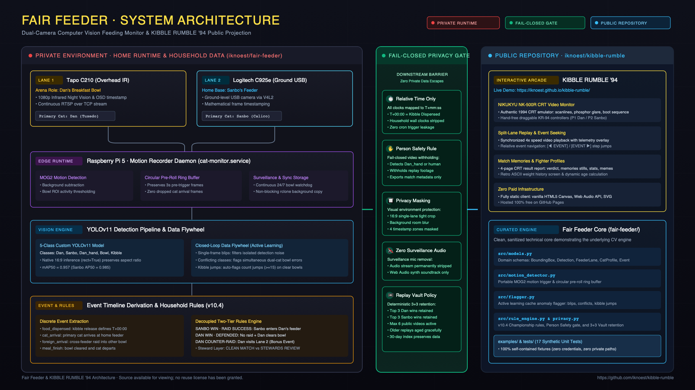

# KIBBLE RUMBLE '94

> **A retro 1994 arcade replay machine and daily cat feeding championship for Dan and Sanbo powered by computer vision.**

🕹️ **[Play Live Demo](https://iknoest.github.io/kibble-rumble/)** · 📐 **[Technical Architecture](#technical-architecture)** · 🐾 **[Fair Feeder Core](fair-feeder/README.md)**

## Quick Navigation

- 🕹️ **[Live Demo](https://iknoest.github.io/kibble-rumble/)** — Playable 1994 CRT arcade replay machine in your browser.
- 📐 **[Technical Architecture](#technical-architecture)** — Dual-camera edge CV, MOG2, YOLOv11, and fail-closed privacy gate.
- 🐾 **[Fair Feeder Core](fair-feeder/README.md)** — Curated computer-vision engine, domain models, and test fixtures.

## What is this?

**KIBBLE RUMBLE '94** turns Dan and Sanbo's daily morning breakfast into an interactive retro arcade championship. Powered by computer-vision detection and automated feeding analysis, each morning's feeding session becomes a playable arcade tape on the fictional **NIKUKYU NK-500R** color video monitor.

## The Real Setup

This isn't a synthetic simulation — it runs on a real dual-feeder multi-camera setup in the home:

- **Two Feeders, Two Bowls**: Dan and Sanbo each have their own automated feeding station in separate areas of the home.
- **Dan's Feeder (Lane 1)**: Monitored 24/7 by an overhead Tapo C210 infrared camera. This is the primary defense arena where Dan's breakfast is dispensed.
- **Sanbo's Feeder (Lane 2)**: Monitored by a ground-level Logitech C925e USB camera. This is Sanbo's personal feeding station and home base.
- **The Core Premise**: The match outcome centers on whether Dan can successfully defend **Dan's bowl**.
- **Sanbo Raids**: Sanbo wins the championship game layer by crossing over and entering Dan's feeder area while food is present.
- **Dan Counter-Raids**: Dan can also sneak over to visit Sanbo's feeder, triggering bonus counter-raid events on the timeline!

## Technical Architecture

KIBBLE RUMBLE '94 is powered by **Fair Feeder**, an edge computer-vision feeding monitor:

| Stage | Subsystem | Description |
| :--- | :--- | :--- |
| **1. Dual Feeders** | Tapo C210 + Logitech C925e | 24/7 IR overhead monitor on Lane 1 (Dan) + ground USB monitor on Lane 2 (Sanbo). |
| **2. Edge Capture** | Raspberry Pi 5 (`MOG2`) | Background subtraction with circular pre-roll ring buffer; zero dropped frames. |
| **3. Vision Core** | Custom YOLOv11 | 5 domain classes (`Dan`, `Sanbo`, `Dan_hand`, `Bowl`, `Kibble`) with active learning flywheel. |
| **4. Game Rules** | Rule Engine (`v10.4`) | Discrete timeline event extraction and deterministic match outcome resolution. |
| **5. Privacy Gate** | Fail-Closed Sanitizer | Wall-clock to relative match time ($T+00:00$), 16:9 crop framing, person safety withholding, no audio. |
| **6. Public Arcade** | GitHub Pages (`KR94`) | Interactive NIKUKYU NK-500R CRT replay monitor with playable daily matches. |

> 📖 **Deep Dive**: Read the complete technical specification in [`fair-feeder/architecture.md`](fair-feeder/architecture.md), or explore the curated engine code in [`fair-feeder/`](fair-feeder/README.md).

## The Contestants

- 🥊 **Dan (P1)**: 5-year-old Tuxedo cat. Defending champion at Dan's bowl. Role: defends his breakfast.
- 😼 **Sanbo (P2)**: 1-year-old Calico cat. Agile challenger and raid specialist. Role: raids Dan's bowl.

## Championship Rules

- **Dan Win · Defended**: Sanbo never enters Dan's bowl area, and Dan successfully clears his breakfast.
- **Sanbo Win · Raid Success**: Sanbo enters Dan's bowl area and eats Dan's kibble.
- **Dan Counter-Raid**: Bonus event if Dan visits Sanbo's feeder while Sanbo is elsewhere.
- **No Contest / Void**: Unresolved attribution, sensor blackout, or interrupted match.

## Privacy & Sanitization

All public media published to this repository is automatically sanitized:
- **Relative Match Time**: Household wall-clock times are replaced with relative match time ($T+00:00 = \text{Kibble Drop}$).
- **Person Safety Rule**: Fail-closed withholding of replay video if human presence is detected (`Dan_hand`).
- **Privacy Masking**: Household backgrounds and absolute timestamps are masked.
- **Single-Camera Framing**: Evidence stills and replays isolate the feeding area in clean 16:9 crops.
- **No Audio**: Surveillance audio is completely stripped from public replay clips.
- **Deterministic Retention**: Replay vault retains max 6 active matches (top 3 Dan wins + top 3 Sanbo wins).

---

*Powered by [Fair Feeder](fair-feeder/README.md) · Hosted on GitHub Pages · Zero paid infrastructure*
