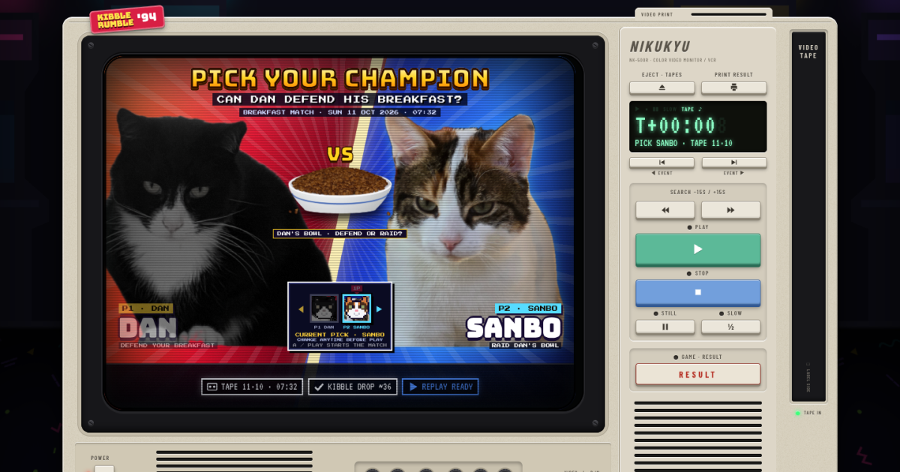
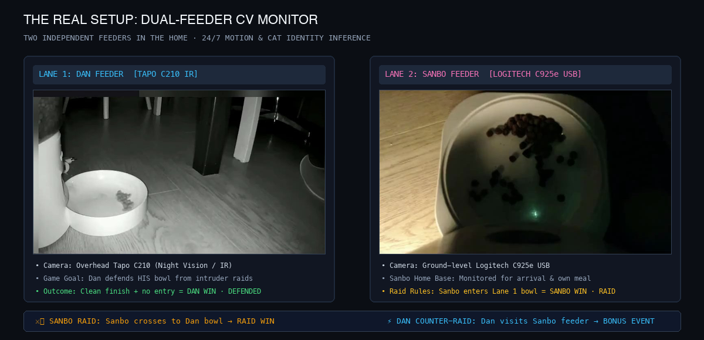

# KIBBLE RUMBLE '94

> **A retro 1994 arcade replay machine and daily cat feeding championship for Dan and Sanbo powered by computer vision.**

🕹️ **[Play Live Demo — https://iknoest.github.io/kibble-rumble/](https://iknoest.github.io/kibble-rumble/)**



## What is this?

**KIBBLE RUMBLE '94** turns Dan and Sanbo's daily morning breakfast into an interactive retro arcade championship. Powered by computer-vision detection and automated feeding analysis, each morning's feeding session becomes a playable arcade tape on the fictional **NIKUKYU NK-500R** color video monitor.

## The Real Setup



This isn't a synthetic simulation — it runs on a real dual-feeder multi-camera setup in the home:

- **Two Feeders, Two Bowls**: Dan and Sanbo each have their own automated feeding station in separate areas of the home.
- **Dan's Feeder (Lane 1)**: Monitored 24/7 by an overhead Tapo C210 infrared camera. This is the primary defense arena where Dan's breakfast is dispensed.
- **Sanbo's Feeder (Lane 2)**: Monitored by a ground-level Logitech C925e USB camera. This is Sanbo's personal feeding station and home base.
- **The Core Premise**: The match outcome centers on whether Dan can successfully defend **Dan's bowl**.
- **Sanbo Raids**: Sanbo wins the championship game layer by crossing over and entering Dan's feeder area while food is present.
- **Dan Counter-Raids**: Dan can also sneak over to visit Sanbo's feeder, triggering bonus counter-raid events on the timeline!

## The Contestants

- 🥊 **Dan (P1)**: 5-year-old Tuxedo cat. Defending champion at Dan's bowl. Role: defends his breakfast.
- 😼 **Sanbo (P2)**: 1-year-old Calico cat. Agile challenger and raid specialist. Role: raids Dan's bowl.

## Championship Rules

- **Dan Win · Defended**: Sanbo never enters Dan's bowl area, and Dan successfully clears his breakfast.
- **Sanbo Win · Raid Success**: Sanbo enters Dan's bowl area and eats Dan's kibble.
- **Dan Counter-Raid**: Bonus event if Dan visits Sanbo's feeder while Sanbo is elsewhere.
- **No Contest / Void**: Unresolved attribution, sensor blackout, or interrupted match.

## How It Works

```
[ Automated Feeders & Cameras ]
             │
             ▼
[ Computer-Vision Detection (YOLO) ]
             │
             ▼
[ Event Timeline & Game Logic ]
             │
             ▼
[ Privacy Sanitization & Projection ]
             │
             ▼
[ KIBBLE RUMBLE '94 Arcade Site (GitHub Pages) ]
```

1. **Daily Feeding**: Automated cameras record breakfast activity across both feeding stations.
2. **Vision Analysis**: Object detection tracks bowl states, kibble counts, and cat movements.
3. **Daily Replay Tape**: Every morning generates a new arcade tape with key match moments (Kibble Drop, Arrivals, Raids, Bowl Cleared).
4. **Replay Vault**: Retains a rolling 30-day index and a curated vault of the best Dan defenses and Sanbo raids.

## Privacy & Sanitization

All public media published to this repository is automatically sanitized:
- **Relative Match Time**: Household wall-clock times are replaced with relative match time ($T+00:00 = \text{Kibble Drop}$).
- **Privacy Masking**: Household backgrounds and absolute timestamps are masked.
- **Single-Camera Framing**: Evidence stills and replays isolate the feeding area in clean 16:9 crops.
- **No Audio**: Surveillance audio is completely stripped from public replay clips.

---

*Powered by Fair Feeder · Hosted on GitHub Pages · Zero paid infrastructure*
